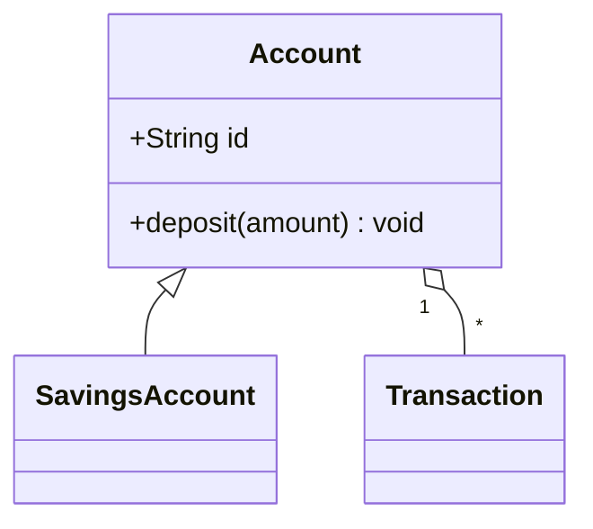
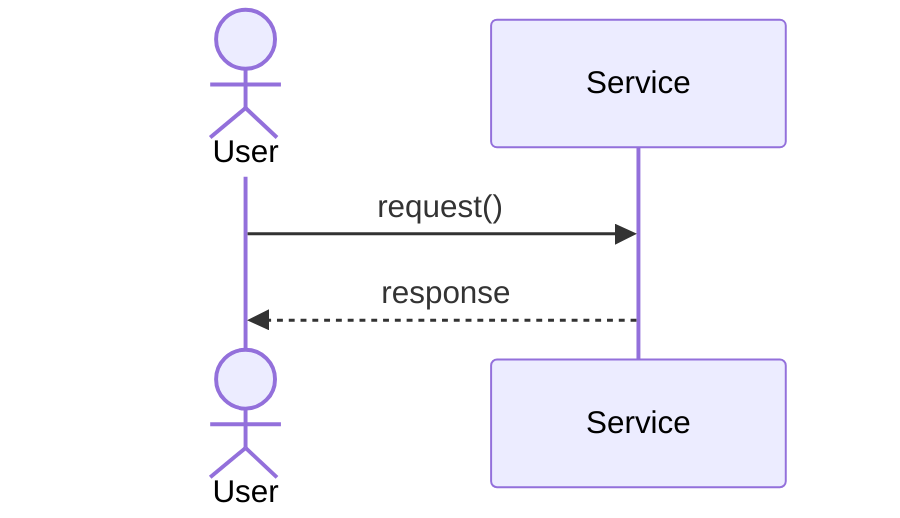
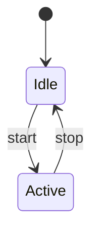
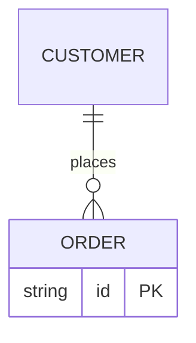

# LDD Practice Lab

An interactive, browser-based environment for practicing **Low-Level Design (LDD)**
interview and exercise questions — writing requirements and drawing UML diagrams
(class, sequence, state, ER) with live preview and reference solutions to compare
against.

No build step, no server required. It's plain HTML/CSS/JS and renders diagrams
with [Mermaid](https://mermaid.js.org/) loaded from a CDN.

## Run it

**Recommended — run the bundled server** (gives you durable saves on disk):

```
node proxy-server.js
# then open http://localhost:8787/
```

This single server serves the app, persists your work to `./saves/<problem>.json`,
and exposes the optional LLM eval proxy. No API key is needed just to save.

**Or open it directly / with any static server:**

```
# Windows
start index.html
# or any static server
npx serve .
python -m http.server
```

> The only online dependency is the Mermaid script from jsDelivr (for diagram
> rendering). Everything else works offline. If you're fully offline, download
> `mermaid.min.js` and point the `<script>` tag in `index.html` at a local copy.

### Where your work is saved

- **With `node proxy-server.js` (recommended):** clicking **Save** (and autosave)
  writes to `./saves/<problem>.json` on disk. This **survives server restarts**,
  closing the browser, and even switching browsers — reopen `http://localhost:8787/`
  and your work loads back. The header shows “Durable saves on”.
- **Without the server (static file or `file://`):** work is saved to the
  browser's `localStorage`. That persists across restarts **only on the same
  origin** (same scheme+host+port). If you switch ports (e.g. `serve` vs
  `http.server`) or open via `file://`, the browser treats it as a different
  store and your earlier saves won't appear. Running the bundled server avoids
  this entirely.

The app autodetects the server at startup and prefers the disk copy, using
`localStorage` as a fast cache + offline fallback.

## What you can do

- **Pick a problem** from the dropdown. Six classic LDD prompts are included:
  Parking Lot, Elevator Control, Library Management, Vending Machine,
  Ride-Hailing, and URL Shortener.
- **Read the brief** (left panel) with scope and expandable hints.
- **Write requirements** (center → *Requirements* tab): actors, functional and
  non-functional requirements, core entities, APIs/methods, assumptions.
- **Self-check** against a per-problem checklist with a live score.
- **Draw diagrams** (center → *Class / Sequence / State / ER* tabs) in Mermaid
  with a split code/preview that renders as you type. Use **Insert template**
  to get a starting skeleton.
- **Write code** (center → *Code* tab): a mini multi-file project. Use
  **＋ File** / **＋ Folder** to build a tree (e.g. `src/model/User.java`),
  click a file to edit it in CodeMirror, and delete with the ✕ on hover. The
  editor language follows the file extension automatically. Files aren't
  executed — they exist so you (and the evaluator) can see your class structure
  and separation of concerns. The whole tree is saved per problem and sent to
  the LLM.
  - **Autocomplete:** for Java (`.java`), Python (`.py`), and C++
    (`.cpp/.cc/.h/.hpp/.c`) files you get a completion popup — it auto-appears as
    you type an identifier, or press **Ctrl-Space** to open it. Suggestions
    combine words already in your file with that language's keywords and common
    library names (e.g. `ArrayList`, `enumerate`, `vector`). It's lightweight
    word/keyword completion, not a full language server.
- **Get an LLM evaluation** (center → *Evaluation* tab): submit your attempt and
  an LLM scores it against an LLD rubric and gives concrete suggestions. See
  [LLM evaluation](#llm-evaluation) below.
- **Reveal the reference solution** (right panel) once you've attempted it —
  design notes plus rendered model diagrams.
- **Timer** to simulate interview pressure.
- **Autosave + durable Save** — your work is saved per problem and restored on
  return. With the bundled server it's written to disk (`./saves/`) and survives
  restarts; otherwise it's stored in the browser. **Save** forces a save;
  **Reset** clears the current problem (locally and on disk); **Export** downloads
  your attempt as Markdown (with Mermaid code
  blocks that render on GitHub).

## Writing diagrams (Mermaid cheat sheet)

**Class diagram**


**Sequence diagram**


**State diagram**


**ER diagram**


Full syntax reference: https://mermaid.js.org/intro/

## LLM evaluation

Open the *Evaluation* tab and click **⚙ LLM Settings**. Pick a provider: an API
(Gemini / OpenAI / Anthropic), or **Kiro (manual)**.

### Kiro (manual) mode — evaluate with the Kiro IDE agent

The app is a static page and can't call the Kiro IDE agent directly, so this mode
is a one-paste round-trip instead of an API call:

1. Choose provider **Kiro (manual)** in ⚙ LLM Settings (no key needed), save.
2. Click **🤖 Evaluate my solution**. The app builds a grading prompt (your
   requirements + diagrams + all code files + the rubric) and **copies it to your
   clipboard** (buttons also let you re-copy or download it).
3. Paste it into the **Kiro IDE chat** and send. Kiro replies with a JSON result.
4. Click **⬇ Import result**, paste that JSON, and **Render result** — it shows in
   the same score/rubric UI as the API providers.

### API modes

For Gemini / OpenAI / Anthropic there are two sub-modes.

### Mode 1 — Bring your own key (zero setup)

Pick a provider (Google Gemini, OpenAI, or Anthropic), enter a model, and paste
your API key. Click **Evaluate my solution** and the app sends your requirements,
diagrams, and code straight to the provider and renders a scored rubric with
suggestions.

- Suggested models: `gemini-3.8-flash` (default) or any Gemini model you have
  access to, `gpt-4o-mini` (OpenAI), `claude-3-5-sonnet-latest` (Anthropic).
  Gemini calls use the `v1` endpoint; just type the exact model name you were
  given and it's passed straight through.
- Get a Gemini key from Google AI Studio (https://aistudio.google.com/app/apikey).
- The key is stored **only** in your browser's `localStorage` and sent directly
  to the provider from the page. Use this on your own machine only.
- **CORS note:** browsers may block direct calls depending on the provider and
  your environment. Gemini and OpenAI generally allow it; if you hit a CORS or
  network error, switch to the proxy mode below.

### Mode 2 — Local proxy (key stays server-side)

Run the bundled proxy so your key never touches the browser. No npm install needed
(plain Node 18+).

```powershell
# PowerShell — Gemini
$env:LLM_PROVIDER="gemini"; $env:GEMINI_API_KEY="..."; node proxy-server.js

# PowerShell — OpenAI
$env:LLM_PROVIDER="openai"; $env:OPENAI_API_KEY="sk-..."; node proxy-server.js

# PowerShell — Anthropic
$env:LLM_PROVIDER="anthropic"; $env:ANTHROPIC_API_KEY="sk-ant-..."; node proxy-server.js
```

```bash
# bash
LLM_PROVIDER=gemini GEMINI_API_KEY=... node proxy-server.js
```

Then in **⚙ LLM Settings** choose *Local proxy server* and set the URL to
`http://localhost:8787/evaluate`. Check `http://localhost:8787/health` to confirm
it's up. Env vars: `PORT`, `LLM_PROVIDER`, `LLM_MODEL`, `GEMINI_API_KEY`,
`OPENAI_API_KEY`, `ANTHROPIC_API_KEY`.

### What the rubric scores

Overall 0–100 plus six dimensions (0–10 each): requirements completeness, entity/
class modeling, class diagram quality, interactions (sequence/state), code quality
& OOP design, and extensibility & patterns — each with a short comment, followed by
strengths and actionable improvements.

## Project structure

| File               | Purpose                                                      |
|--------------------|--------------------------------------------------------------|
| `index.html`       | App shell: 3-panel layout and tabs.                          |
| `styles.css`       | Dark theme and layout.                                       |
| `problems.js`      | The problem library + reference solutions (edit to add more).|
| `llm.js`           | LLM client: settings, prompt/rubric, provider calls.         |
| `app.js`           | All interactivity: tabs, editors, persistence, evaluation.   |
| `proxy-server.js`  | Local server: serves the app, durable disk saves, LLM proxy. |
| `saves/`           | Created at runtime — one JSON file per saved problem.        |

## Add your own problem

Append an entry to the `PROBLEMS` array in `problems.js`:

```js
{
  id: "chess",                    // unique slug
  title: "Chess Game",
  difficulty: "medium",           // easy | medium | hard
  brief: "Design the object model for a chess game...",
  scope: ["In-scope bullet", "..."],
  hints: ["A hint", "..."],
  checklist: ["Thing to verify", "..."],
  solution: {
    notes: ["Design note", "..."],
    diagrams: {
      class:    "classDiagram\n    class Board { }",
      sequence: "sequenceDiagram\n    actor Player",
      // state / er optional
    }
  }
}
```

It shows up in the dropdown automatically on reload.

## Notes

- Work is stored under `localStorage` keys prefixed `ldd-lab:`. Clearing browser
  storage removes saved attempts.
- All six bundled reference diagrams are validated to parse with Mermaid 10.
